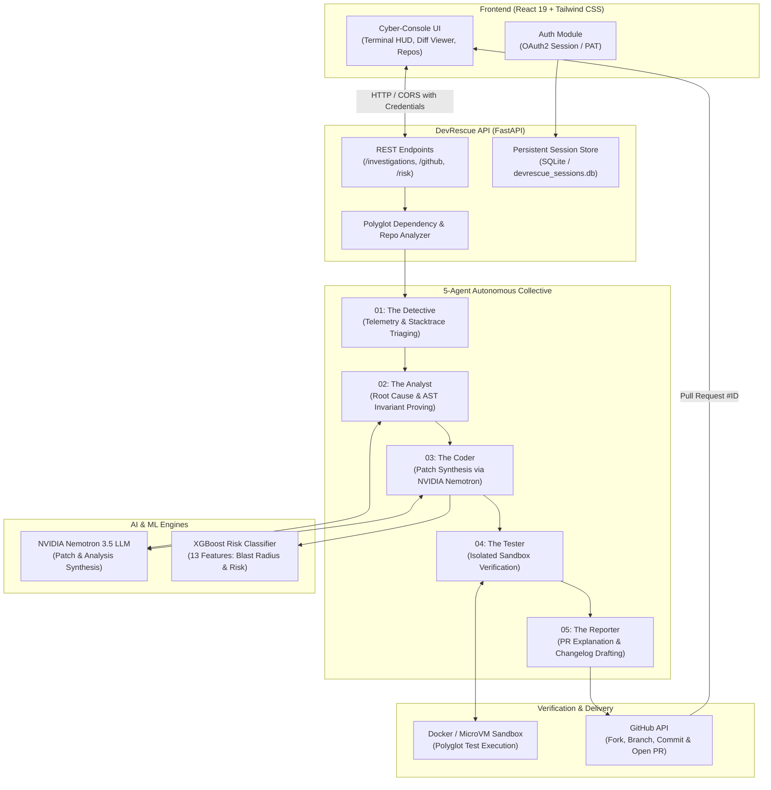

# DevRescue AI — Autonomous Bug Investigation & Repair Console

<p align="center">
  <strong>"Broken code, rescued in seconds."</strong><br />
  An autonomous cyber-console & multi-agent engineering platform for continuous software reliability.
</p>

<p align="center">
  <a href="https://dev-rescue-ai.vercel.app"></a>
  <a href="#-tech-stack"></a>
  <a href="#-tech-stack"></a>
  <a href="#-tech-stack"></a>
  <a href="#-tech-stack"></a>
  <a href="#-tech-stack"></a>
</p>

---

## 📑 Table of Contents

- [Overview](#-overview)
- [System Architecture](#-system-architecture)
- [The 5 Specialized Autonomous AI Agents](#-the-5-specialized-autonomous-ai-agents)
- [Key Features](#-key-features)
- [Tech Stack](#-tech-stack)
- [Project Directory Structure](#-project-directory-structure)
- [Quickstart & Local Setup](#-quickstart--local-setup)
  - [Prerequisites](#prerequisites)
  - [1. Clone Repository](#1-clone-the-repository)
  - [2. Backend Setup](#2-backend-setup)
  - [3. Frontend Setup](#3-frontend-setup)
- [Environment Variables Guide](#-environment-variables-guide)
- [Running with Docker](#-running-with-docker)
- [API Reference](#-api-reference)
- [ML Risk Model & Verification](#-ml-risk-model--verification)
- [Running Automated Tests](#-running-automated-tests)
- [Production Deployment](#-production-deployment)
- [Making the Repository Public](#-making-the-repository-public)
- [Contributing & License](#-contributing--license)

---

## ⚡ Overview

**DevRescue AI** is an end-to-end autonomous software maintenance platform designed to reduce mean time to resolution (MTTR) for software regressions and bugs from hours to seconds.

When a bug report, runtime crash, or GitHub issue is detected, DevRescue AI orchestrates a pipeline of **five specialized AI agents** that:
1. Triage stack traces and isolate failure locations across polyglot repositories.
2. Formally prove root causes via AST inspection and execution path analysis.
3. Synthesize minimal, production-grade patches conforming to project idioms using **NVIDIA Nemotron 3.5**.
4. Assess patch regression probability using a custom **13-feature XGBoost ML model**.
5. Execute regression tests in an **isolated Docker sandbox**.
6. Dispatch verified **GitHub Pull Requests** complete with semantic changelogs, execution logs, and blast-radius summaries.

All operations stream real-time telemetry to a cyberpunk-inspired cyber-console equipped with CRT scanlines, live log streams, and an interactive side-by-side diff viewer.

---

## 🏗️ System Architecture



---

## 🤖 The 5 Specialized Autonomous AI Agents

DevRescue AI does not rely on a monolithic prompt. Instead, it delegates bug resolution across an orchestrated pipeline of five specialized agents:

| Agent | Codename | Primary Responsibility | Capabilities & Output |
| :--- | :--- | :--- | :--- |
| **01** | **The Detective** | Telemetry & Stacktrace Triaging | Ingests raw stack traces, runtime exceptions, and GitHub issue bodies. Pinpoints affected files, line numbers, and dependencies. |
| **02** | **The Analyst** | Root Cause & Invariant Proving | Performs Abstract Syntax Tree (AST) traversal, variable invariant checking, and control-flow evaluation to isolate why the fault occurs. |
| **03** | **The Coder** | Patch Synthesis & Minimal Diffs | Harnesses **NVIDIA Nemotron 3.5** to write minimal, surgically scoped diffs that solve the root cause without touching extraneous lines. |
| **04** | **The Tester** | Stress Emulation & CI Verification | Runs tests in an isolated microVM/Docker sandbox. Validates that previously failing tests pass and no regression tests break. |
| **05** | **The Reporter** | PR Explanation & Changelog Drafting | Generates Conventional Commit messages, comprehensive PR markdown breakdowns, test reproduction steps, and opens the GitHub PR. |

---

## ✨ Key Features

- **Real GitHub API & OAuth / PAT Integration**:
  - Connect your GitHub account via standard OAuth or fine-grained Personal Access Token (PAT).
  - Browse your repositories, branches, open issues, and pull requests in real time.
  - Automatically forks, creates targeted fix branches, applies patches, and submits pull requests under your authenticated identity.
- **13-Feature Machine Learning Regression Risk Engine**:
  - Built-in trained XGBoost model (`devrescue_risk_model.pkl`) trained on code maintenance datasets.
  - Evaluates patch attributes including files changed, churn (lines added/deleted), cyclomatic complexity delta, dependency updates, and test outcomes.
  - Classifies patches into `LOW`, `MEDIUM`, or `HIGH` risk with probability distributions and blast-radius indicators.
- **Polyglot & Multi-Language Support**:
  - Built-in profiling and test running for Python (`pytest`, `unittest`), JavaScript/TypeScript (`npm test`, `jest`, `vitest`), and node environments.
  - Isolated runner fallback when Docker daemon is not active.
- **Strict Diff Validation Guardrails**:
  - Diffs pass through `diff_validator.py` enforcing hunk headers, valid path checks, prevent directory traversal attacks, and restrict churn to safe boundaries.
- **Cyberpunk Terminal HUD & Real-time Console**:
  - Sleek dark cyber canvas (`#090A0F`) with CRT scanlines toggle, emerald/cyan accents, and high-density telemetry metric cards.
  - Interactive Monaco/VS Code-inspired side-by-side and unified diff viewer.
  - Seamless Light / Dark theme switching across the entire application.
- **Zero-Secret Client Architecture**:
  - Sensitive API keys (GitHub client secrets, NVIDIA tokens) reside strictly on the backend.
  - Sessions are managed via secure HTTP-only cookies and SQLite-backed cryptographically hashed records.

---

## 🛠️ Tech Stack

### Frontend
- **Framework**: [React 19](https://react.dev/) + [Vite 8](https://vitejs.dev/)
- **Routing**: [React Router v7](https://reactrouter.com/)
- **Styling**: [Tailwind CSS 3](https://tailwindcss.com/) + Custom Cyberpunk Glow Utilities
- **Icons**: [Lucide React](https://lucide.dev/)
- **Hosting**: [Vercel](https://vercel.com/) (Production: [dev-rescue-ai.vercel.app](https://dev-rescue-ai.vercel.app))

### Backend
- **Framework**: [FastAPI 0.110+](https://fastapi.tiangolo.com/) (Asynchronous ASGI server)
- **ASGI Server**: [Uvicorn](https://www.uvicorn.org/)
- **Schema & Validation**: [Pydantic v2](https://docs.pydantic.dev/)
- **Session Store**: [SQLite](https://www.sqlite.org/) with WAL mode and cryptographic HMAC token masking
- **HTTP Client**: [HTTPX](https://www.python-httpx.org/)

### Artificial Intelligence & Machine Learning
- **LLM**: [NVIDIA Nemotron 3.5](https://build.nvidia.com/) (`nvidia/nemotron-3.5-lightning-30b-a3b` via NVIDIA API / Nebius)
- **ML Classifier**: [XGBoost 2.0+](https://xgboost.readthedocs.io/) & [Scikit-learn](https://scikit-learn.org/)
- **Serialization**: [Joblib](https://joblib.readthedocs.io/)

### DevOps & Containers
- **Containerization**: [Docker](https://www.docker.com/) (Multi-stage Python 3.11-slim container)
- **PaaS Deployment**: Procfile & Dockerfile ready for Render, Railway, Fly.io, or Heroku

---

## 📂 Project Directory Structure

```text
DevRescue-AI/
├── backend/
│   ├── app/
│   │   ├── api/                     # FastAPI route controllers
│   │   │   ├── github.py            # GitHub OAuth, PAT, repos, issues & PR endpoints
│   │   │   ├── health.py            # System & ML health probes
│   │   │   ├── investigations.py    # Autonomous investigation lifecycle
│   │   │   ├── nemotron.py          # NVIDIA Nemotron LLM inference routes
│   │   │   ├── pull_requests.py     # Pull request dispatch & history
│   │   │   ├── repair_queue.py      # Multi-repository queue manager
│   │   │   ├── repositories.py      # Repository analysis & connection
│   │   │   ├── risk.py              # XGBoost ML risk prediction endpoint
│   │   │   └── sandbox.py           # Docker & local sandbox test runner
│   │   ├── core/
│   │   │   └── config.py            # Pydantic environment configuration & CORS
│   │   ├── ml/                      # Machine Learning model artifacts
│   │   │   ├── devrescue_risk_model.pkl   # Serialized XGBoost classifier
│   │   │   ├── devrescue_features.json    # 13 required feature names
│   │   │   └── risk_label_mapping.json    # LOW / MEDIUM / HIGH labels
│   │   ├── schemas/                 # Pydantic request / response schemas
│   │   ├── services/                # Business logic services
│   │   │   ├── diff_validator.py    # Strict unified diff syntax validator
│   │   │   ├── github_service.py    # GitHub REST API v3 client
│   │   │   ├── investigation_service.py
│   │   │   ├── nemotron_service.py  # NVIDIA Nemotron LLM integration
│   │   │   ├── patch_service.py     # Synthesizes, applies, and verifies patches
│   │   │   ├── repository_analyzer.py
│   │   │   ├── risk_prediction_service.py
│   │   │   ├── sandbox_service.py   # Isolated execution runner
│   │   │   └── session_store.py     # Persistent SQLite session store
│   │   └── main.py                  # FastAPI application entrypoint & middleware
│   ├── tests/                       # Comprehensive Pytest suite (25+ test files)
│   ├── Dockerfile                   # Backend Dockerfile
│   ├── Procfile                     # Heroku / Railway web process config
│   ├── requirements.txt             # Python production dependencies
│   └── verify_model.py              # ML environment & inference verification script
├── src/                             # React 19 Frontend
│   ├── assets/                      # Static branding & images
│   ├── components/
│   │   ├── common/                  # DiffViewer, TerminalLog, Modal, ThemeToggle, etc.
│   │   ├── dashboard/               # Multi-repo queue & HUD cards
│   │   └── investigation/           # Pipeline progress, root cause, security, test results
│   ├── context/                     # AppContext, AuthContext, ThemeContext
│   ├── layouts/                     # AppLayout, PublicLayout, ProtectedRoute
│   ├── pages/
│   │   ├── agents/                  # Agent collective status overview
│   │   ├── analytics/               # System reliability & MTTR metrics
│   │   ├── auth/                    # GitHub OAuth / PAT sign-in
│   │   ├── dashboard/               # Central operations dashboard
│   │   ├── investigations/          # Live investigation console & history
│   │   ├── public/                  # Landing page & documentation
│   │   ├── pull-requests/           # Dispatched pull requests monitor
│   │   ├── repositories/            # Connected repository catalog
│   │   └── settings/                # User & API configuration
│   ├── services/                    # Axios/Fetch API client wrappers
│   ├── App.jsx                      # Client router configuration
│   └── main.jsx                     # Vite DOM bootstrap
├── docker/                          # Test harness Dockerfiles
├── .env.example                     # Frontend environment template
├── backend/.env.example             # Backend environment template
├── Dockerfile                       # Production containerfile (Root context)
├── package.json                     # Frontend dependencies & scripts
├── tailwind.config.js               # Cyberpunk theme colors & animations
├── vercel.json                      # Vercel SPA rewrite routing rules
└── vite.config.js                   # Vite bundler configuration
```

---

## 🚀 Quickstart & Local Setup

### Prerequisites
- **Node.js**: `v18.0.0` or higher ([Download Node.js](https://nodejs.org/))
- **Python**: `3.10` or `3.11` ([Download Python](https://www.python.org/))
- **Git**: Installed and configured on your system
- **Docker** *(Optional, recommended for sandboxed test execution)*: [Docker Desktop](https://www.docker.com/)

---

### 1. Clone the Repository

```bash
git clone https://github.com/RudraPatel217/DevRescue-AI-.git
cd DevRescue-AI-
```

---

### 2. Backend Setup

1. **Navigate to the backend directory**:
   ```bash
   cd backend
   ```

2. **Create and activate a virtual environment**:
   - On Windows (PowerShell):
     ```powershell
     python -m venv .venv
     .venv\Scripts\Activate.ps1
     ```
   - On macOS / Linux:
     ```bash
     python3 -m venv .venv
     source .venv/bin/activate
     ```

3. **Install backend dependencies**:
   ```bash
   pip install --upgrade pip
   pip install -r requirements.txt
   ```

4. **Configure backend environment variables**:
   Create a `.env` file in the `backend/` folder (or copy from `.env.example`):
   ```bash
   cp .env.example .env
   ```
   Edit `backend/.env` with your API credentials:
   ```env
   HOST=0.0.0.0
   PORT=8000
   FRONTEND_URL=http://localhost:5173
   ALLOWED_ORIGINS=http://localhost:5173,http://127.0.0.1:5173

   # GitHub OAuth or PAT
   GITHUB_CLIENT_ID=your_github_oauth_client_id
   GITHUB_CLIENT_SECRET=your_github_oauth_client_secret
   GITHUB_REDIRECT_URI=http://localhost:8000/api/github/callback

   # NVIDIA Nemotron LLM (NVIDIA API Catalog)
   NVIDIA_API_KEY=nvapi-your_key_here
   NVIDIA_BASE_URL=https://integrate.api.nvidia.com/v1
   NEMOTRON_MODEL=nvidia/nemotron-3.5-lightning-30b-a3b
   ```

5. **Verify the ML model**:
   ```bash
   python verify_model.py
   ```

6. **Start the FastAPI backend server**:
   ```bash
   uvicorn app.main:app --host 0.0.0.0 --port 8000 --reload
   ```
   *The API will be available at [http://localhost:8000](http://localhost:8000), and interactive Swagger docs at [http://localhost:8000/docs](http://localhost:8000/docs).*

---

### 3. Frontend Setup

1. **Open a new terminal window** and navigate to the project root:
   ```bash
   cd DevRescue-AI-
   ```

2. **Install frontend dependencies**:
   ```bash
   npm install
   ```

3. **Configure frontend environment variables**:
   Create a `.env` file in the root directory:
   ```env
   VITE_API_URL=http://localhost:8000
   ```

4. **Start the Vite development server**:
   ```bash
   npm run dev
   ```
   *The UI will launch at [http://localhost:5173](http://localhost:5173).*

---

## 🔑 Environment Variables Guide

### Backend (`backend/.env`)

| Variable | Required | Default | Description |
| :--- | :---: | :--- | :--- |
| `PORT` | Optional | `8000` | Port for the FastAPI server to bind to. |
| `HOST` | Optional | `0.0.0.0` | Host address for FastAPI server. |
| `FRONTEND_URL` | Yes | `http://localhost:5173` | Allowed frontend origin for CORS and OAuth redirects. |
| `ALLOWED_ORIGINS` | Optional | `http://localhost:5173` | Comma-separated list of allowed CORS origins. |
| `GITHUB_CLIENT_ID` | Optional | `""` | GitHub OAuth App Client ID (for OAuth web flow). |
| `GITHUB_CLIENT_SECRET` | Optional | `""` | GitHub OAuth App Client Secret. |
| `GITHUB_REDIRECT_URI` | Optional | `http://localhost:8000/api/github/callback` | OAuth redirect callback URL. |
| `NVIDIA_API_KEY` | Optional | `""` | NVIDIA API Key for Nemotron 3.5 LLM patch synthesis. |
| `NVIDIA_BASE_URL` | Optional | `https://integrate.api.nvidia.com/v1` | Base URL for the NVIDIA / Nebius LLM API. |
| `NEMOTRON_MODEL` | Optional | `nvidia/nemotron-3.5-lightning-30b-a3b` | Target LLM model identifier. |

### Frontend (`.env`)

| Variable | Required | Default | Description |
| :--- | :---: | :--- | :--- |
| `VITE_API_URL` | Yes | `http://localhost:8000` | Base URL of the backend FastAPI service. |

---

## 🐳 Running with Docker

Run the entire backend service in a production-ready container:

```bash
# 1. Build the Docker image from root
docker build -t devrescue-backend -f Dockerfile .

# 2. Run the container with your environment variables
docker run -d \
  -p 8000:8000 \
  -e PORT=8000 \
  -e FRONTEND_URL="http://localhost:5173" \
  -e NVIDIA_API_KEY="your_nvidia_api_key" \
  --name devrescue-api \
  devrescue-backend
```

---

## 🔌 API Reference

### Health & Diagnostics
- `GET /health` — Overall system status, FastAPI state, and ML model readiness.
- `GET /api/risk/health` — Detailed health check for the XGBoost risk model.

### GitHub Integration & Session
- `GET /api/github/login` — Initiates GitHub OAuth2 authorization flow.
- `GET /api/github/callback` — Handles OAuth callback and sets secure session cookie.
- `POST /api/github/pat` — Authenticates directly using a personal access token.
- `GET /api/github/user` — Returns authenticated user profile.
- `POST /api/github/logout` — Revokes session and clears authentication cookies.

### Repository & Queue Management
- `GET /api/repositories` — Lists accessible repositories for the authenticated user.
- `POST /api/repositories/connect` — Manually registers or imports a repository.
- `GET /api/repositories/{owner}/{repo}/branches` — Lists repository branches.
- `GET /api/repositories/{owner}/{repo}/issues` — Fetches open issues ready for investigation.
- `GET /api/repair-queue` — Retrieves current queue of pending bug investigations.

### AI Investigation & Patch Synthesis
- `POST /api/investigations` — Initiates an investigation run for an issue.
- `GET /api/investigations` — Lists current and historical investigations.
- `GET /api/investigations/{id}` — Fetches full telemetry, logs, and patch diff for an investigation.
- `POST /api/ai/nemotron/investigate` — Runs NVIDIA Nemotron 3.5 deep investigation.
- `POST /api/ai/nemotron/patch` — Generates and validates a minimal unified diff patch.

### Machine Learning Risk Prediction
- `POST /api/risk/predict` — Evaluates patch risk using the 13-feature XGBoost model:
  ```json
  {
    "files_changed": 1,
    "lines_added": 8,
    "lines_removed": 2,
    "total_changed_lines": 10,
    "patch_size": 420,
    "functions_changed": 1,
    "classes_changed": 0,
    "cyclomatic_complexity": 2.0,
    "code_size": 1500,
    "dependency_changes": 0,
    "test_count": 12,
    "tests_passed": 12,
    "tests_failed": 0
  }
  ```

### Pull Requests
- `POST /api/pull-requests/create` — Creates branch, pushes commits, and opens verified pull request on GitHub.
- `GET /api/pull-requests` — Lists created pull requests and their CI status.

---

## 🧠 ML Risk Model & Verification

DevRescue AI includes a trained machine learning model located at `backend/app/ml/devrescue_risk_model.pkl`. It inspects patch metrics to prevent high-risk code changes from being merged automatically.

To test the model standalone:

```bash
cd backend
python verify_model.py
```

Expected output:
```text
=== STEP 1: ENVIRONMENT VERIFICATION ===
FastAPI version: 0.110.0+
XGBoost version: 2.x.x
Scikit-learn version: 1.4.x

=== STEP 2: ML MODEL VERIFICATION ===
Model type: XGBClassifier
model.n_features_in_: 13
devrescue_features count: 13
Sample prediction: LOW with probabilities: [0.88, 0.09, 0.03]

ALL ENVIRONMENT AND ML MODEL CHECKS PASSED SUCCESSFULLY!
```

---

## 🧪 Running Automated Tests

DevRescue AI contains an extensive test suite covering API routes, GitHub mock flows, diff validation, isolation runners, and Nemotron timeouts:

```bash
# Activate virtual environment
cd backend

# Run all tests
pytest -v

# Run targeted test suites
pytest tests/test_health.py tests/test_risk.py
pytest tests/test_diff_validator.py
pytest tests/test_github.py
```

---

## 🌐 Production Deployment

### Frontend (Vercel)
The React SPA is configured with `vercel.json` for client-side routing.
1. Connect your repository to [Vercel](https://vercel.com/).
2. Set build command: `npm run build`
3. Set output directory: `dist`
4. Set environment variable: `VITE_API_URL=https://your-backend-api-url.com`

### Backend (Docker / Render / Railway)
The backend includes a root `Dockerfile` and `Procfile`:
1. **Railway / Render**: Connect repo and specify `Dockerfile` or start command:
   ```bash
   uvicorn app.main:app --app-dir backend --host 0.0.0.0 --port $PORT --workers 1
   ```
2. Set production environment variables (`NVIDIA_API_KEY`, `FRONTEND_URL`, etc.).

---

## 🔓 Making the Repository Public

If your GitHub repository is currently set to **Private** and you want to make it **Public**, follow these quick steps:

### Option 1: Via the GitHub Web UI (Recommended)
1. Go to your repository settings page:
   - For fork / personal repo: [`https://github.com/RudraPatel217/DevRescue-AI-/settings`](https://github.com/RudraPatel217/DevRescue-AI-/settings)
   - For main upstream repo: [`https://github.com/AP2203/DevRescue-AI-/settings`](https://github.com/AP2203/DevRescue-AI-/settings)
2. In the left sidebar, click **General** (the top option).
3. Scroll down to the very bottom to the **Danger Zone** section.
4. Locate **Change repository visibility** and click the **Change visibility** button.
5. Select **Make public**.
6. Review the prompt and click **I understand, make this repository public**.

### Option 2: Via GitHub CLI (`gh`)
If you have the [GitHub CLI](https://cli.github.com/) installed and authenticated:
```bash
gh repo edit RudraPatel217/DevRescue-AI- --visibility public --accept-visibility-change-consequences
```

### Option 3: Via GitHub REST API
With a Personal Access Token that has `repo` admin privileges:
```bash
curl -X PATCH \
  -H "Authorization: Bearer YOUR_GITHUB_PAT" \
  -H "Accept: application/vnd.github+json" \
  https://api.github.com/repos/RudraPatel217/DevRescue-AI- \
  -d '{"private": false}'
```

---

## 👥 Contributing

1. Fork the Project (`git checkout -b feature/AmazingFeature`)
2. Commit your Changes (`git commit -m 'feat: Add some AmazingFeature'`)
3. Push to the Branch (`git push origin feature/AmazingFeature`)
4. Open a Pull Request

---

## 📄 License

This project is licensed under the MIT License — see the [LICENSE](LICENSE) file for details.

<p align="center">
  Built with ❤️ by the DevRescue AI Team
</p>
