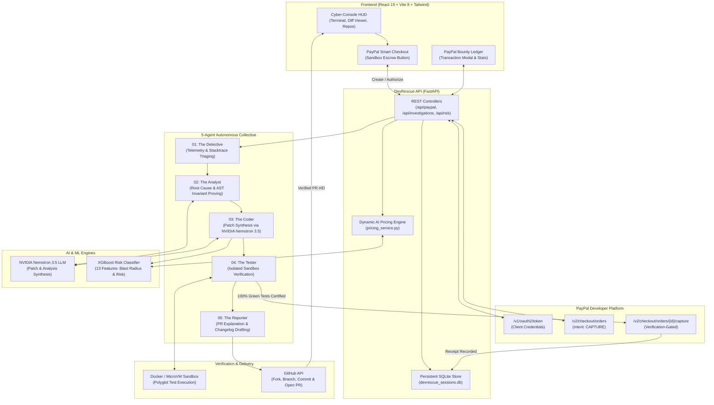

# DevRescue AI — Autonomous Bug Investigation & Repair Console

<p align="center">
  <strong>"Broken code, rescued in seconds."</strong><br />
  An autonomous cyber-console & multi-agent engineering platform with <strong>PayPal Developer Platform Sandbox</strong> integration for dynamic AI bug bounties & verification-gated escrow repair payments.
</p>

<p align="center">
  <a href="https://dev-rescue-ai.vercel.app"></a>
  <a href="#-paypal-developer-platform-integration"></a>
  <a href="#-deploy-to-render"></a>
  <a href="#-tech-stack"></a>
  <a href="#-tech-stack"></a>
  <a href="#-tech-stack"></a>
  <a href="#-tech-stack"></a>
  <a href="#-tech-stack"></a>
</p>

---

## 📑 Table of Contents

- [Overview](#-overview)
- [PayPal Developer Platform Integration](#-paypal-developer-platform-integration)
  - [Dynamic AI Bug Bounty Pricing Engine](#1-dynamic-ai-bug-bounty-pricing-engine)
  - [100% Verification-Gated Escrow Protocol](#2-100-verification-gated-escrow-protocol)
  - [PayPal Sandbox Testing Guide for Judges](#3-paypal-sandbox-testing-guide-for-judges)
- [System Architecture](#-system-architecture)
- [The 5 Specialized Autonomous AI Agents](#-the-5-specialized-autonomous-ai-agents)
- [Key Features](#-key-features)
- [Tech Stack](#-tech-stack)
- [Project Directory Structure](#-project-directory-structure)
- [Quickstart & Local Setup](#-quickstart--local-setup)
  - [Prerequisites](#prerequisites)
  - [1. Clone Repository](#1-clone-the-repository)
  - [2. Backend Setup](#2-backend-setup)
  - [3. Frontend Setup](#3-frontend-setup)
- [Environment Variables Guide](#-environment-variables-guide)
- [Deploy to Render](#-deploy-to-render)
- [Running with Docker](#-running-with-docker)
- [API Reference](#-api-reference)
- [Verification Suites (ML Risk & PayPal)](#-verification-suites-ml-risk--paypal)
- [Running Automated Tests](#-running-automated-tests)
- [Production Deployment](#-production-deployment)
- [Contributing & License](#-contributing--license)

---

## ⚡ Overview

**DevRescue AI** is an autonomous software engineering and continuous reliability platform that cuts mean time to resolution (MTTR) for software bugs from hours to seconds.

Built for the **PayPal AI Hackathon**, DevRescue AI unites the **PayPal Developer Platform (Orders API v2 & Sandbox)** with a collective of **five specialized AI agents**, a **13-feature XGBoost regression risk engine**, and **NVIDIA Nemotron 3.5 LLM**:

1. Maintainers and developers fund automated bug rescues via **PayPal Sandbox Checkout**.
2. An AI pricing engine calculates a dynamic fix price quote based on code complexity and crash severity.
3. The funds are held safely in **PayPal Escrow**.
4. The 5-agent pipeline analyzes the repository, proves root causes, synthesizes surgically minimal patches, and runs regression suites in an isolated microVM/Docker sandbox.
5. **Zero-Risk Guarantee**: The PayPal order is only captured when Agent 04 certifies **100% passing tests** and opens the verified GitHub pull request. If the fix fails verification, the maintainer pays nothing!

---

## 💳 PayPal Developer Platform Integration

DevRescue AI meaningfully integrates the **PayPal Developer Platform (v2 Orders API & Sandbox)** to establish the industry's first **AI-Quoted, Verification-Gated Bug Bounty & Repair Escrow**:

```
[ GitHub Issue / Bug Crash ]
              │
              ▼
  [ 13-Feature XGBoost ML + Detective ]
  Quotes Dynamic Bounty: $15.00 – $119.25 USD
              │
              ▼
  [ PayPal Orders API v2 (intent: CAPTURE) ]
  Maintainer approves via PayPal Sandbox Checkout
  Funds placed in Escrow (`CREATED` / `APPROVED`)
              │
              ▼
  [ 5-Agent Collective: Coder + Tester Sandbox ]
  Executes isolated polyglot regression tests
              │
       ┌──────┴──────┐
       ▼             ▼
[ 100% Green Tests ]   [ Tests Fail / Timeout ]
       │                         │
[ PayPal Capture ]        [ Escrow Cancelled / Refund ]
Funds Captured (Orders API) Zero developer risk
Verified PR opened on GitHub
```

### 1. Dynamic AI Bug Bounty Pricing Engine
Rather than flat rate pricing, DevRescue AI uses its trained **13-feature XGBoost regression risk model** + AST analyzer to dynamically quote fair repair prices based on:
- **Abstract Syntax Tree (AST) Complexity Delta**: Evaluates cyclomatic complexity.
- **Blast Radius & Churn**: Lines added/removed and files impacted.
- **MicroVM / Docker Compute**: Size of unit and regression test suites.
- **Critical Failure Triggers**: Automatic surcharges for fatal exceptions (e.g. `deadlock`, `race condition`, `memory leak`, `segmentation fault`).

### 2. 100% Verification-Gated Escrow Protocol
- **Creation**: When a maintainer initializes an investigation order, the backend calls `POST /v2/checkout/orders` with `intent: "CAPTURE"` and sets up the escrow record in the SQLite persistence ledger.
- **Escrow Hold**: The maintainer authorizes the payment using PayPal Sandbox Smart Checkout.
- **Automated Capture**: When Agent 04 (The Tester) runs the regression test suite inside the container and confirms **100% green tests**, the backend invokes `POST /v2/checkout/orders/{id}/capture` to capture the bounty and dispatches the PR to GitHub.
- **Persistent Ledger**: Maintainers can review all past bounties, escrow statuses, order IDs, and verification receipts by opening the **PayPal Bounties** ledger in the app navigation.

### 3. PayPal Sandbox Testing Guide for Judges
Judges can test the full PayPal experience in two ways:
1. **Interactive Sandbox Checkout**:
   - Create a free developer sandbox account at [developer.paypal.com](https://developer.paypal.com/).
   - Add your sandbox `PAYPAL_CLIENT_ID` and `PAYPAL_CLIENT_SECRET` in `backend/.env`.
   - Log in using your PayPal Sandbox personal buyer account during checkout.
2. **Instant Sandbox Evaluation Mode (Zero Configuration Required)**:
   - If no sandbox credentials are provided, the system defaults to `client_id: "sb"` and initiates a high-fidelity Sandbox Simulation with compliant `ORDER-SB-xxxx` identifiers and `CAP-SB-xxxx` verification capture receipts!
   - Run the instant standalone test:
     ```bash
     python backend/verify_paypal.py
     ```

---

## 🏗️ System Architecture



---

## 🤖 The 5 Specialized Autonomous AI Agents

| Agent | Codename | Primary Responsibility | Capabilities & Output |
| :--- | :--- | :--- | :--- |
| **01** | **The Detective** | Telemetry & Stacktrace Triaging | Ingests crash dumps, stack traces, and GitHub issues. Pinpoints bug loci and extracts risk features for PayPal dynamic bounty quoting. |
| **02** | **The Analyst** | Root Cause & Invariant Proving | Traverses Abstract Syntax Trees (AST) and control flow graphs to prove why invariants failed. |
| **03** | **The Coder** | Patch Synthesis & Minimal Diffs | Leverages **NVIDIA Nemotron 3.5** to write surgically minimal, idiomatic patches conforming to repository formatting. |
| **04** | **The Tester** | Stress Emulation & CI Verification | Executes tests in an isolated microVM/Docker sandbox. **Triggers PayPal bounty capture upon certifying 100% green tests.** |
| **05** | **The Reporter** | PR Explanation & Changelog Drafting | Generates Conventional Commits, detailed markdown changelogs, test execution proofs, and opens the GitHub PR. |

---

## ✨ Key Features

- **PayPal Developer Platform Sandbox & Orders API v2**:
  - Full end-to-end integration with `/v1/oauth2/token`, `/v2/checkout/orders`, and `/v2/checkout/orders/{id}/capture`.
  - Zero-risk verification-gated escrow: funds only captured upon 100% green test suite certification.
- **Dynamic AI Bug Bounty Quoting**:
  - Leverages 13-feature XGBoost ML model to calculate transparent repair fees based on code complexity, churn, and failure severity.
- **Real GitHub API & OAuth / PAT Integration**:
  - Authenticate via GitHub OAuth2 or Personal Access Tokens.
  - Automatically forks repos, creates fix branches, commits patches, and files verified pull requests.
- **13-Feature Machine Learning Regression Risk Engine**:
  - Serialized XGBoost model (`devrescue_risk_model.pkl`) trained on code maintenance datasets.
  - Classifies patches into `LOW`, `MEDIUM`, or `HIGH` risk with blast-radius indicators.
- **Isolated Docker Container Sandbox**:
  - Runs polyglot test harnesses (Python `pytest`, JavaScript `jest`/`vitest`, Node) in isolated microVM/Docker containers.
- **Cyberpunk Terminal HUD & Real-time Console**:
  - Sleek dark cyber canvas (`#090A0F`) with CRT scanlines, live log streams, and an interactive side-by-side diff viewer.
- **Persistent SQLite Session & Transaction Store**:
  - Securely manages encrypted user sessions and PayPal bounty transaction histories with zero secret leakage.

---

## 🛠️ Tech Stack

### Payments & Developer Platform
- **Payments Platform**: [PayPal Developer Platform](https://developer.paypal.com/) (Orders API v2, OAuth2, Sandbox Checkout)
- **Deployment Sponsor**: [Render](https://render.com/) (Infrastructure-as-Code via `render.yaml`)

### Artificial Intelligence & Machine Learning
- **LLM**: [NVIDIA Nemotron 3.5](https://build.nvidia.com/) (`nvidia/nemotron-3.5-lightning-30b-a3b` via NVIDIA API / Nebius)
- **ML Classifier**: [XGBoost 2.0+](https://xgboost.readthedocs.io/) & [Scikit-learn](https://scikit-learn.org/)
- **Model Serialization**: [Joblib](https://joblib.readthedocs.io/)

### Backend
- **Framework**: [FastAPI 0.110+](https://fastapi.tiangolo.com/) (Asynchronous ASGI server)
- **ASGI Server**: [Uvicorn](https://www.uvicorn.org/)
- **Schema & Validation**: [Pydantic v2](https://docs.pydantic.dev/)
- **Session & Ledger Store**: [SQLite](https://www.sqlite.org/) with WAL mode and cryptographic HMAC token masking
- **HTTP Client**: [HTTPX](https://www.python-httpx.org/)

### Frontend
- **Framework**: [React 19](https://react.dev/) + [Vite 8](https://vitejs.dev/)
- **Routing**: [React Router v7](https://reactrouter.com/)
- **Styling**: [Tailwind CSS 3](https://tailwindcss.com/) + Custom Cyberpunk Glow Utilities
- **Icons**: [Lucide React](https://lucide.dev/)
- **Hosting**: [Vercel](https://vercel.com/) (Production: [dev-rescue-ai.vercel.app](https://dev-rescue-ai.vercel.app))

---

## 📂 Project Directory Structure

```text
DevRescue-AI/
├── backend/
│   ├── app/
│   │   ├── api/                     # FastAPI route controllers
│   │   │   ├── paypal.py            # PayPal Orders API, quotes & transactions
│   │   │   ├── github.py            # GitHub OAuth, PAT, repos & PR endpoints
│   │   │   ├── health.py            # System & ML health probes
│   │   │   ├── investigations.py    # Autonomous investigation lifecycle
│   │   │   ├── nemotron.py          # NVIDIA Nemotron LLM inference routes
│   │   │   ├── pull_requests.py     # Pull request dispatch & history
│   │   │   ├── repair_queue.py      # Multi-repository queue manager
│   │   │   ├── repositories.py      # Repository analysis & connection
│   │   │   ├── risk.py              # XGBoost ML risk prediction endpoint
│   │   │   └── sandbox.py           # Docker & local sandbox test runner
│   │   ├── core/
│   │   │   └── config.py            # Pydantic configuration & PayPal credentials
│   │   ├── ml/                      # Machine Learning model artifacts
│   │   │   ├── devrescue_risk_model.pkl   # Serialized XGBoost classifier
│   │   │   ├── devrescue_features.json    # 13 required feature names
│   │   │   └── risk_label_mapping.json    # LOW / MEDIUM / HIGH labels
│   │   ├── schemas/                 # Pydantic schemas
│   │   │   ├── paypal.py            # PayPal orders, quotes & transaction schemas
│   │   │   └── investigations.py
│   │   ├── services/                # Business logic services
│   │   │   ├── paypal_service.py    # PayPal Orders API v2 Client & Sandbox
│   │   │   ├── pricing_service.py   # AI Dynamic Bug Bounty Quoting Engine
│   │   │   ├── diff_validator.py    # Strict unified diff syntax validator
│   │   │   ├── github_service.py    # GitHub REST API v3 client
│   │   │   ├── investigation_service.py
│   │   │   ├── nemotron_service.py  # NVIDIA Nemotron LLM integration
│   │   │   ├── patch_service.py     # Synthesizes, applies, and verifies patches
│   │   │   ├── risk_prediction_service.py
│   │   │   ├── sandbox_service.py   # Isolated execution runner
│   │   │   └── session_store.py     # SQLite session & PayPal bounty ledger
│   │   └── main.py                  # FastAPI application entrypoint & middleware
│   ├── tests/                       # Pytest test suites (including test_paypal.py)
│   ├── verify_paypal.py             # Standalone PayPal & AI Bounty verification script
│   ├── verify_model.py              # ML environment & inference verification script
│   ├── Dockerfile                   # Backend Dockerfile
│   ├── Procfile                     # Heroku / Railway web process config
│   └── requirements.txt             # Python production dependencies
├── src/                             # React 19 Frontend
│   ├── components/
│   │   ├── common/
│   │   │   ├── PayPalBountyCard.jsx         # Interactive PayPal Bounty & Escrow Card
│   │   │   ├── PayPalTransactionsModal.jsx  # PayPal Bug Bounty Ledger & Escrows
│   │   │   ├── DiffViewer.jsx               # Side-by-side / unified diff viewer
│   │   │   └── TerminalLog.jsx              # Real-time cyberpunk terminal HUD
│   │   ├── dashboard/               # Multi-repo queue & HUD cards
│   │   └── investigation/           # Pipeline progress, root cause, security, test results
│   ├── context/                     # AppContext, AuthContext, ThemeContext
│   ├── layouts/                     # AppLayout (with PayPal Bounties modal trigger)
│   ├── pages/
│   │   ├── investigations/          # NewInvestigation (with PayPal) & LiveInvestigation
│   │   ├── dashboard/               # Central operations dashboard
│   │   └── ...
│   └── services/                    # API client with PayPal endpoints
├── render.yaml                      # Render Blueprint (Infrastructure-as-Code)
├── .env.example                     # Frontend environment template
├── backend/.env.example             # Backend environment template
├── Dockerfile                       # Production containerfile (Root context)
├── package.json                     # Frontend dependencies & scripts
├── LICENSE                          # Open-source MIT License
└── vercel.json                      # Vercel SPA routing rules
```

---

## 🚀 Quickstart & Local Setup

### Prerequisites
- **Node.js**: `v18.0.0` or higher ([Download Node.js](https://nodejs.org/))
- **Python**: `3.10` or `3.11` ([Download Python](https://www.python.org/))
- **Git**: Installed and configured on your system
- **Docker** *(Optional, recommended for sandboxed test execution)*: [Docker Desktop](https://www.docker.com/)

---

### 1. Clone the Repository

```bash
git clone https://github.com/RudraPatel217/DevRescue-AI-.git
cd DevRescue-AI-
```

---

### 2. Backend Setup

1. **Navigate to the backend directory**:
   ```bash
   cd backend
   ```

2. **Create and activate a virtual environment**:
   - On Windows (PowerShell):
     ```powershell
     python -m venv .venv
     .venv\Scripts\Activate.ps1
     ```
   - On macOS / Linux:
     ```bash
     python3 -m venv .venv
     source .venv/bin/activate
     ```

3. **Install backend dependencies**:
   ```bash
   pip install --upgrade pip
   pip install -r requirements.txt
   ```

4. **Configure backend environment variables**:
   Create a `.env` file in the `backend/` folder (or copy from `.env.example`):
   ```bash
   cp .env.example .env
   ```
   Edit `backend/.env` with your API credentials:
   ```env
   HOST=0.0.0.0
   PORT=8000
   FRONTEND_URL=http://localhost:5173
   ALLOWED_ORIGINS=http://localhost:5173,http://127.0.0.1:5173

   # PayPal Developer Platform (Sandbox)
   PAYPAL_CLIENT_ID=your_paypal_sandbox_client_id
   PAYPAL_CLIENT_SECRET=your_paypal_sandbox_client_secret
   PAYPAL_MODE=sandbox
   PAYPAL_API_BASE=https://api-m.sandbox.paypal.com

   # GitHub OAuth or PAT
   GITHUB_CLIENT_ID=your_github_oauth_client_id
   GITHUB_CLIENT_SECRET=your_github_oauth_client_secret
   GITHUB_REDIRECT_URI=http://localhost:8000/api/github/callback

   # NVIDIA Nemotron LLM (NVIDIA API Catalog)
   NVIDIA_API_KEY=nvapi-your_key_here
   NVIDIA_BASE_URL=https://integrate.api.nvidia.com/v1
   NEMOTRON_MODEL=nvidia/nemotron-3.5-lightning-30b-a3b
   ```

5. **Run the Standalone Verification Scripts**:
   ```bash
   # Verify ML XGBoost Model
   python verify_model.py

   # Verify PayPal Orders API v2 & AI Bounty Escrow
   python verify_paypal.py
   ```

6. **Start the FastAPI backend server**:
   ```bash
   uvicorn app.main:app --host 0.0.0.0 --port 8000 --reload
   ```
   *The API will be available at [http://localhost:8000](http://localhost:8000), and interactive Swagger docs at [http://localhost:8000/docs](http://localhost:8000/docs).*

---

### 3. Frontend Setup

1. **Open a new terminal window** and navigate to the project root:
   ```bash
   cd DevRescue-AI-
   ```

2. **Install frontend dependencies**:
   ```bash
   npm install
   ```

3. **Configure frontend environment variables**:
   Create a `.env` file in the root directory:
   ```env
   VITE_API_URL=http://localhost:8000
   VITE_PAYPAL_CLIENT_ID=sb
   ```

4. **Start the Vite development server**:
   ```bash
   npm run dev
   ```
   *The UI will launch at [http://localhost:5173](http://localhost:5173).*

---

## 🔑 Environment Variables Guide

### Backend (`backend/.env`)

| Variable | Required | Default | Description |
| :--- | :---: | :--- | :--- |
| `PAYPAL_CLIENT_ID` | Optional | `sb` | PayPal Sandbox Client ID (from developer.paypal.com). |
| `PAYPAL_CLIENT_SECRET` | Optional | `""` | PayPal Sandbox Client Secret. |
| `PAYPAL_MODE` | Optional | `sandbox` | PayPal environment mode (`sandbox` or `live`). |
| `PAYPAL_API_BASE` | Optional | `https://api-m.sandbox.paypal.com` | Base REST endpoint for PayPal Sandbox. |
| `PORT` | Optional | `8000` | Port for the FastAPI server to bind to. |
| `FRONTEND_URL` | Yes | `http://localhost:5173` | Allowed frontend origin for CORS and OAuth redirects. |
| `NVIDIA_API_KEY` | Optional | `""` | NVIDIA API Key for Nemotron 3.5 LLM patch synthesis. |
| `NEMOTRON_MODEL` | Optional | `nvidia/nemotron-3.5-lightning-30b-a3b` | Target LLM model identifier. |

### Frontend (`.env`)

| Variable | Required | Default | Description |
| :--- | :---: | :--- | :--- |
| `VITE_API_URL` | Yes | `http://localhost:8000` | Base URL of the backend FastAPI service. |
| `VITE_PAYPAL_CLIENT_ID` | Optional | `sb` | Public PayPal Client ID for Smart Buttons. |

---

## 🚀 Deploy to Render

DevRescue AI includes a pre-configured **Render Blueprint** ([`render.yaml`](render.yaml)) for one-click deployment:

1. Fork or clone this repository to your GitHub account.
2. Sign in to your [Render Dashboard](https://dashboard.render.com/).
3. Click **New +** and select **Blueprint**.
4. Connect this repository — Render will automatically read `render.yaml` and configure:
   - Python 3.11 environment
   - Uvicorn web service with health check on `/health`
   - Pre-populated PayPal Sandbox environment variables
5. Click **Apply** to deploy!

---

## 🐳 Running with Docker

Run the entire backend service in a production-ready container:

```bash
# 1. Build the Docker image from root
docker build -t devrescue-backend -f Dockerfile .

# 2. Run the container with your environment variables
docker run -d \
  -p 8000:8000 \
  -e PORT=8000 \
  -e FRONTEND_URL="http://localhost:5173" \
  -e PAYPAL_MODE="sandbox" \
  -e PAYPAL_CLIENT_ID="your_paypal_client_id" \
  -e PAYPAL_CLIENT_SECRET="your_paypal_client_secret" \
  -e NVIDIA_API_KEY="your_nvidia_api_key" \
  --name devrescue-api \
  devrescue-backend
```

---

## 🔌 API Reference

### PayPal Developer Platform & Bounties
- `GET /api/paypal/config` — Returns public PayPal configuration (client ID, mode, currency).
- `POST /api/paypal/quote` — Calculates AI-driven dynamic bounty quote using XGBoost risk & code complexity.
- `POST /api/paypal/orders/create` — Creates order with `intent=CAPTURE` via PayPal v2 Orders API.
- `POST /api/paypal/orders/{id}/capture` — Captures payment upon 100% green test verification.
- `GET /api/paypal/orders/{id}` — Queries live order status from PayPal or transaction store.
- `GET /api/paypal/transactions` — Lists recent bounties, escrow statuses, and capture receipts.

### Health & Diagnostics
- `GET /health` — Overall system status, FastAPI state, and ML model readiness.
- `GET /api/risk/health` — Detailed health check for the XGBoost risk model.

### GitHub Integration & Session
- `GET /api/github/login` — Initiates GitHub OAuth2 authorization flow.
- `GET /api/github/callback` — Handles OAuth callback and sets secure session cookie.
- `POST /api/github/pat` — Authenticates directly using a personal access token.
- `GET /api/github/user` — Returns authenticated user profile.

### AI Investigation & Patch Synthesis
- `POST /api/investigations` — Initiates an investigation run with optional PayPal bounty binding.
- `GET /api/investigations` — Lists current and historical investigations.
- `GET /api/investigations/{id}` — Fetches full telemetry, logs, and patch diff for an investigation.
- `POST /api/ai/nemotron/investigate` — Runs NVIDIA Nemotron 3.5 deep investigation.
- `POST /api/ai/nemotron/patch` — Generates and validates a minimal unified diff patch.

### Machine Learning Risk Prediction
- `POST /api/risk/predict` — Evaluates patch risk using the 13-feature XGBoost model:
  ```json
  {
    "files_changed": 1,
    "lines_added": 8,
    "lines_removed": 2,
    "total_changed_lines": 10,
    "patch_size": 420,
    "functions_changed": 1,
    "classes_changed": 0,
    "cyclomatic_complexity": 2.0,
    "code_size": 1500,
    "dependency_changes": 0,
    "test_count": 12,
    "tests_passed": 12,
    "tests_failed": 0
  }
  ```

---

## 🧠 Verification Suites (ML Risk & PayPal)

DevRescue AI includes two standalone verification scripts for judges and contributors:

### 1. PayPal & AI Bounty Escrow Verification
```bash
cd backend
python verify_paypal.py
```
**Output:**
```text
=== STEP 1: VERIFYING PAYPAL PUBLIC CONFIG ===
PayPal Config: {'client_id': 'sb', 'mode': 'sandbox', 'configured': False, 'currency': 'USD'}

=== STEP 2: VERIFYING AI DYNAMIC BOUNTY QUOTING ===
Quoted Bounty Amount: $ 119.25 USD
Risk Tier: HIGH
Complexity Score: 10.0
Breakdown: {'base_fee': 65.0, 'complexity_fee': 11.25, 'blast_radius_fee': 8.0, 'sandbox_compute_fee': 5.0, 'nemotron_reasoning_fee': 16.25, 'severity_surcharge': 30.0, 'detected_critical_factors': ['deadlock', 'race condition'], 'predicted_risk_score': 0.9988}

=== STEP 3: CREATING PAYPAL ORDER (INTENT=CAPTURE) ===
Created Order ID: ORDER-SB-F9069DDA4CCD
Order Status: CREATED
Approval URL: https://www.sandbox.paypal.com/checkoutnow?token=ORDER-SB-F9069DDA4CCD

=== STEP 4: VERIFYING-GATED ORDER CAPTURE (100% GREEN TESTS) ===
Capture ID: CAP-SB-CF4A92DADA
Capture Status: COMPLETED
Green Tests Verified: True
Message: Payment captured successfully upon 100% green test suite verification by Agent 04.

=== STEP 5: VERIFYING TRANSACTION PERSISTENCE IN SQLITE ===
Retrieved 1 transactions from persistent ledger:
  - Order ORDER-SB-F9069DDA4CCD | Amount: $119.25 USD | Status: COMPLETED

ALL PAYPAL & AI BOUNTY VERIFICATION STEPS PASSED SUCCESSFULLY!
```

### 2. Machine Learning Model Verification
```bash
cd backend
python verify_model.py
```
**Output:**
```text
Model type: XGBClassifier
model.n_features_in_: 13
devrescue_features count: 13
Sample prediction: 2 with probabilities: [4.2566773e-01 3.0319777e-04 5.7402909e-01]

ALL ENVIRONMENT AND ML MODEL CHECKS PASSED SUCCESSFULLY!
```

---

## 🧪 Running Automated Tests

```bash
# Activate virtual environment
cd backend

# Run PayPal & AI unit tests
pytest tests/test_paypal.py -v

# Run entire test suite
pytest -v
```

---

## 👥 Contributing

1. Fork the Project (`git checkout -b feature/AmazingFeature`)
2. Commit your Changes (`git commit -m 'feat: Add some AmazingFeature'`)
3. Push to the Branch (`git push origin feature/AmazingFeature`)
4. Open a Pull Request

---

## 📄 License

This project is licensed under the MIT License — see the [LICENSE](LICENSE) file for details.

<p align="center">
  Built with ❤️ for the <strong>PayPal AI Hackathon</strong>
</p>
